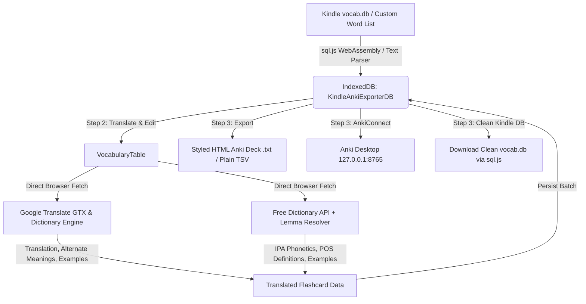

# Kindle Vocabulary to Anki — Architecture & Agent Guide

This document describes the architecture, data flow, and engineering conventions of **Kindle Vocabulary to Anki** (`kindle2anki.online` / `kindletoanki.online`).

## Overview

**Kindle Vocabulary to Anki** is a 100% client-side, autonomous React + TypeScript + Vite Single-Page Application (SPA). It parses Amazon Kindle's SQLite vocabulary database (`vocab.db`) or custom word lists directly in the browser, enriches words with dictionary translations, IPA phonetics, definitions, usage examples, and human MP3 audio pronunciation without any backend server or AI dependencies, and exports ready-to-study flashcards to Anki.

## Core Architecture

### 1. 100% Serverless & AI-Free Dictionary Pipeline (`src/utils/api.ts`)
- **Zero Backend / Zero AI Keys**: All lookups execute directly in the user's browser (`src/utils/api.ts`). There is no Express server or LLM dependency.
- **Translation & Rich Dictionary Extraction**:
  - Primary lookup queries `https://translate.googleapis.com/translate_a/single?client=gtx&dt=t&dt=bd&dt=md&dt=ex` to retrieve primary translations, dictionary synonyms (`dt=bd`), monolingual definitions (`dt=md`), and usage examples (`dt=ex`).
  - Automatic fallback to `https://api.mymemory.translated.net/get` if the primary endpoint is unreachable.
- **Phonetics & Definitions**:
  - Queries `https://api.dictionaryapi.dev/api/v2/entries/en/<word>` with automatic client-side morphological lemma resolution (`guessClientLemmas(word, stem)`) so inflected Kindle words (e.g., `-ed`, `-ing`, `-ies`, `-es`, `-s`) resolve to their base dictionary headword for IPA and definitions.
- **Default Language Pair**:
  - Source language defaults to `auto` (using the `lang` column from Kindle's `WORDS` table or `en`).
  - Target language defaults to **Ukrainian (`uk`)** and persists in `localStorage` (`kindle_target_lang`). Over 14 target languages (including Ukrainian, English, Spanish, German, French, Polish, Russian, etc.) are available in the selector.

### 2. Local SQLite Parsing & Kindle `vocab.db` Cleaner (`src/utils/sqliteParser.ts`)
- **In-Browser SQLite (`sql.js`)**: Loads `sql-wasm.js` in the browser to parse Kindle's `WORDS`, `LOOKUPS`, and `BOOK_INFO` tables locally.
- **Kindle Vocabulary Cleaner**:
  - Stores the original uploaded `vocab.db` binary in IndexedDB (`dbFile` object store) or generates a native Kindle-compatible SQLite schema (`BOOK_INFO`, `WORDS`, `LOOKUPS`, `METADATA`, `DICT_INFO`, `VERSION`) from scratch.
  - Provides a single post-export action (`Download Clean vocab.db` on Step 3) that clears `WORDS` and `LOOKUPS` so users can replace `system/vocabulary/vocab.db` on their Kindle via USB.

### 3. Audio Pronunciation in Browser & Inside Anki (`src/utils/cardTemplates.ts`)
-Anki Desktop uses QtWebEngine (embedded Chromium), where `window.speechSynthesis` is defined as an object but `speechSynthesis.getVoices()` is empty (`[]`), causing standard Web Speech API calls to fail silently inside Anki Desktop.
- Both the web preview (`playWordAudio`) and the exported Anki card HTML (`buildInlineSpeakAttr` in `renderFront` / `renderBack`) use a multi-tier HTML5 `Audio` pipeline:
  1. **Primary**: Google/Oxford Dictionary human US pronunciation MP3 (`https://ssl.gstatic.com/dictionary/static/sounds/oxford/<word>--_us_1.mp3`).
  2. **Stem Fallback**: Oxford Dictionary MP3 for the word's root stem (`<stem>--_us_1.mp3`).
  3. **Dynamic Dictionary MP3 Fallback**: Youdao Dictionary MP3 stream (`https://dict.youdao.com/dictvoice?audio=<word>&type=2`).
  4. **Offline Fallback**: Browser `window.speechSynthesis` when offline and system voices are available.

### 4. Streamlined 3-Step User Flow (No Duplicate Controls)
Each feature appears once in its logical step:
1. **`1. Add Words` (`src/components/UploadPanel.tsx`)**:
   - Upload Kindle `vocab.db` via drag-and-drop or paste a custom word list (`word` or `word - translation`).
   - Includes a 1-click `Try Demo Deck (5 cards)` button with pre-populated sample cards.
2. **`2. Translate & Edit` (`src/components/VocabularyTable.tsx`)**:
   - Progress bar, search input, book filter, status filter (`All`, `Translated`, `Untranslated`), target language selector, and `Translate All` / `Translate (N)` button.
   - Inline card editor modal and bulk selection with optimistic deletion + `Undo` banner (`src/App.tsx`).
3. **`3. Export` (`src/components/AnkiSyncPanel.tsx`)**:
   - Download styled HTML Anki deck (`Kindle_Vocabulary_Deck.txt`) or plain TSV (`Kindle_Vocabulary_Plain.txt`).
   - Interactive Flashcard Preview window (`Front Side` / `Back Side` flip + audio button).
   - Single `Clean Kindle Vocabulary (vocab.db)` card (`Download Clean vocab.db`).
   - Collapsible `Direct Sync with Anki Desktop (AnkiConnect)` panel with a 3-step setup guide and 1-click CORS JSON config for `https://kindle2anki.online`, `https://www.kindle2anki.online`, `https://kindletoanki.online`, and `https://www.kindletoanki.online`.

---

## Project Structure

- `src/App.tsx`: Top-level 3-step navigation bar (`1. Add Words`, `2. Translate & Edit`, `3. Export`), undo toast banner for deletions, and inline `Start New Deck` confirmation.
- `src/components/UploadPanel.tsx`: Step 1 — Kindle `vocab.db` dropzone and Custom Word List importer.
- `src/components/VocabularyTable.tsx`: Step 2 — Translation batch runner, filters, audio preview, bulk deletion, and inline card editor.
- `src/components/AnkiSyncPanel.tsx`: Step 3 — Anki `.txt` export, interactive card preview, Kindle `vocab.db` cleaner, and AnkiConnect sync.
- `src/utils/api.ts`: Autonomous client-side translation and dictionary lookup engine with `AbortSignal` support.
- `src/utils/sqliteParser.ts`: WebAssembly `sql.js` parser for Kindle `vocab.db` and clean `vocab.db` generator.
- `src/utils/cardTemplates.ts`: Styled Light/Dark mode Anki HTML card templates (`renderFront`, `renderBack`) and `playWordAudio` utility.
- `src/utils/csv.ts`: UTF-8 BOM TSV exporter with `#separator:tab` and `#html:true` headers for Anki.
- `src/utils/ankiConnect.ts`: Local `http://127.0.0.1:8765` AnkiConnect integration with automatic basic note type detection (`Basic`, `Базова`, `Простая`, `Einfach`, `Básico`).
- `src/utils/db.ts`: IndexedDB (`KindleAnkiExporterDB`) storage wrapper.
- `src/utils/aiVocabularyParser.ts` & `src/utils/aiVocabularyParser.test.ts`: Pure parser and unit tests for custom word list inputs and client-side lemma guessing.

---

## Engineering Conventions
- **Code & Comments Language**: All source code, identifiers, and code comments must be written strictly in **English**.
- **Documentation Languages**: Repository documentation is maintained in **English** (`README.md`, `Agent.md`) and **Ukrainian** (`README.uk.md`) only.
- **No `window.confirm` / `window.alert`**: Always use inline UI confirmations or undo banners so the app works inside sandboxed iframes and all browsers.
